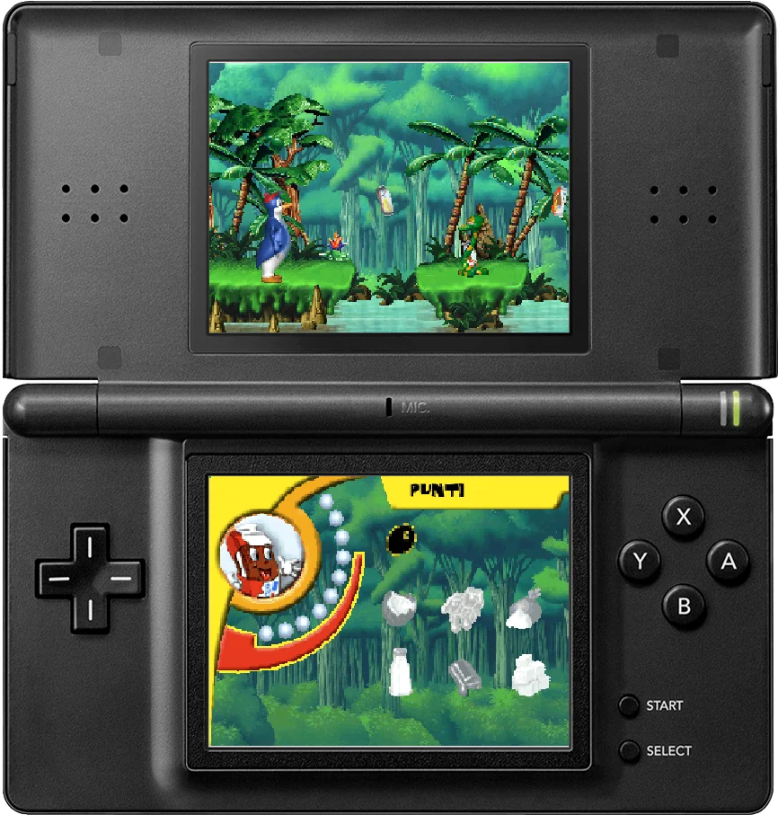

# Kinder Fresh Adventures · Nintendo DS

A Nintendo DS recomp of *Kinder Fresh Adventures Collection*.

Some QoL improvements, like bottom-screen menus with touch support.

<p align="center">
  
</p>

## What is included

The port includes all four worlds, tutorials, enemies and bosses, character switching, items, music and voices, credits, highscores, touch menus and name entry with the DS keyboard. Assets are converted for the DS: native tilemaps and GPU sprites, compact palettes, compressed graphics and ADPCM audio.

This repository contains runtime source, asset converters, tests and documentation. Original game files and generated runtime assets are excluded, apart from the bundled ROM icon. Screenshots illustrate the running port.

## Original disc for source builds

Building from source requires the supported Italian **Kinder Fresh Adventures Collection** ISO. It can be found on [Internet Archive](https://archive.org/details/kinder-fresh-adventures-collection). The build tools verify the disc before extracting it; no Windows installation is required.

| Check | Required value |
|---|---|
| Size | 214,038,528 bytes |
| MD5 | `186e1d22c3cf1d490542399a570e93bb` |
| SHA-256 | `9c6d7b33665ce10d0d2e38277d07ff51b2887c1b348012fd91210abc308458a7` |

The ROM icon is included, already optimized to 32×32 pixels and 15 visible colors.

## Download

Download **Kinder Fresh Adventures.nds** from the [latest GitHub release](https://github.com/grecoluigi/kinder-fresh-adventures-ds/releases/latest). The release includes the compiled ROM and a SHA-256 checksum; no build or ISO is needed to play it.

## Build

Install [BlocksDS](https://blocksds.skylyrac.net/docs/setup/) and its Wonderful toolchain, Python 3.11 or newer, and `unshield`. Development uses BlocksDS 1.24.0. From a fresh checkout:

```sh
python3 -m venv .venv
.venv/bin/python -m pip install -r requirements-assets.txt
.venv/bin/python tools/prepare_assets.py \
  --iso "/path/to/Kinder Fresh Adventures - Collection.iso" \
  --output build/asset-regeneration --through scenery
.venv/bin/python tools/assemble_assets.py \
  --generated build/asset-regeneration --project ds
make -C ds -j4 WONDERFUL_TOOLCHAIN=/path/to/wonderful
```

Output: **`ds/Kinder Fresh Adventures.nds`**, with a SHA-256 checksum alongside it. The converter's output directory must initially be absent. Assembly refuses to overwrite existing runtime asset folders.

See [detailed build and asset instructions](docs/BUILDING.md) for individual stages and verification commands.

## Play and save

Copy `Kinder Fresh Adventures.nds` to a DLDI-compatible flashcart, or open it in a DS emulator.

| Input | Action |
|---|---|
| D-pad | Move, crouch, climb |
| A | Jump / select |
| B | Shoot |
| X | Switch character when available |
| START | Open / close the game menu |
| Touch | Select menu items or tap the HUD portrait to switch characters |

Saving uses a raw 8 KiB `.sav` beside the ROM, with the same filename stem. The loader must provide a writable filesystem and the ROM path. Without a valid ROM path, the fallback is `kinder_fresh.sav` at the writable drive root. To keep a save from an older build, rename its accompanying save to **`Kinder Fresh Adventures.sav`** when renaming the ROM. Keep a backup first.

Credits return to the main menu. The ROM does not attempt to exit to the DS system menu.

## Development and feedback

Normal builds use `KF_DEBUG=0`. Opt into the diagnostic overlay with `make -C ds KF_DEBUG=1`; Y toggles it. The overlay is excluded from release builds.

- [Emulator playtests and logs](tools/PLAYTEST.md)
- [Repository layout and private files](docs/DEVELOPMENT.md)
- [Version history](CHANGELOG.md)

Physical DS testing remains the reference for performance. Automated emulator routes are bounded checks, not proof of full-game completion. Full playthroughs, flashcart save durability and remaining audio/visual edge cases still need verification.

Found a bug? Please open a GitHub issue with the world and location, steps to reproduce it, and your DS model and flashcart/loader or emulator version.

This is an unofficial fan port. Original artwork, audio, characters and trademarks belong to their respective owners.
